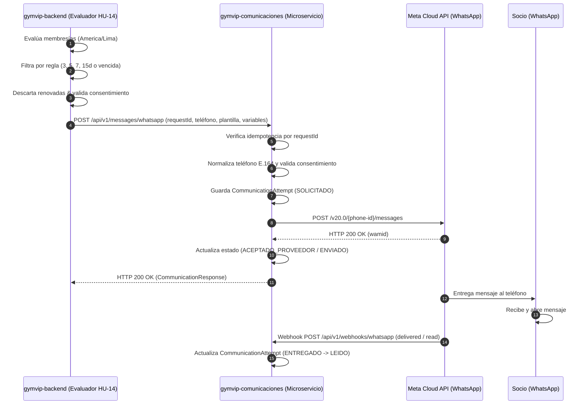
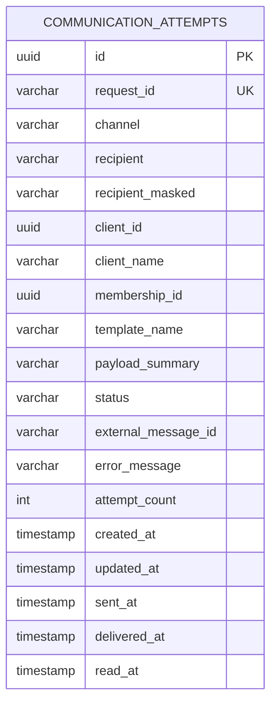

# Arquitectura del Microservicio de Comunicaciones — GYM VIP

> **Ubicación Canónica:** `gymvip-ms-comunicaciones/documentos/ARQUITECTURA_Y_MODELOS.md`  
> **Servicio:** `gymvip-comunicaciones`  
> **Sprint:** Sprint 2 (HU-14, HU-17, HU-18)  

---

## 1. Límites del Sistema y Flujo de Información

```
+---------------------------------------------------------------------------------------+
|                                    GYM VIP ECOSYSTEM                                  |
|                                                                                       |
|   +-----------------------+              +----------------------------------------+   |
|   |    gymvip-frontend    |              |             gymvip-backend             |   |
|   |  - Recordatorios (14) | <== JWT ===> |  - Evaluador de Vencimientos (HU-14)   |   |
|   |  - Comunicaciones(18) |              |  - Membresías & Consentimientos BD     |   |
|   +-----------------------+              +----------------------------------------+   |
|                                                              ||                       |
|                                                 HTTP REST (X-Service-Key)             |
|                                                 Idempotency-Key (requestId)           |
|                                                              \/                       |
|                                          +----------------------------------------+   |
|                                          |        gymvip-ms-comunicaciones        |   |
|                                          |  - Validador E.164 & Consentimiento    |   |
|                                          |  - Registro Auditoría Inmutable        |   |
|                                          |  - Adaptador WhatsApp (Meta / Sim)     |   |
|                                          |  - Webhook Receiver & Status Tracker   |   |
|                                          +----------------------------------------+   |
+--------------------------------------------------------------||-----------------------+
                                                               ||
                                                     Meta Cloud API (v20.0)
                                                     Webhooks (HTTPS POST)
                                                               \/
                                                   +------------------------+
                                                   |     Meta Graph API     |
                                                   |   WhatsApp Business    |
                                                   +------------------------+
```

---

## 2. Diagrama de Secuencia del Flujo de Notificación



---

## 3. Modelo de Dominio de Intentos de Comunicación (ERD)


